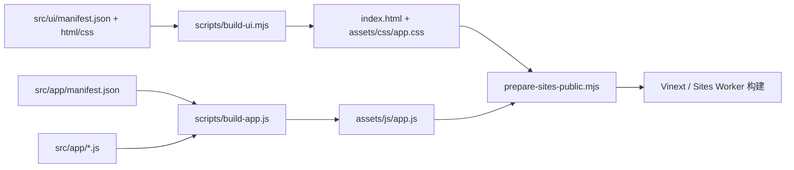

# 源码结构与拆分边界

当前聊天应用的 JS 业务源码位于 `src/app/` 的 24 个业务目录，HTML/CSS 源文件位于 `src/ui/`。新增 `offline/` 只负责应用资源缓存、更新与私有图片副本；用户存储、两套同步协议和 F18/F19 权限边界沿用现有实现。

## 当前业务目录

正则 Worker 专项（2026-10-15）：`assets/js/regex-worker.js` 是隔离程序的唯一源码；`scripts/build-app.js` 在装配 `prompt/40-regex-worker-runtime.js` 时精确替换源码占位，将其作为字符串内嵌。运行时优先使用 Blob Worker 并串行复用，异常/超时销毁后按需重建；同源脚本保留旧标签页和不支持 Blob 的兼容。不额外新增业务分片；缺少源码或占位异常会在写入 bundle 前拒绝构建。构建产物不能手改。`test-regex-worker-browser.mjs` 已纳入第七组发布浏览器检查，覆盖首次完全断网、复用、真实超时后重建、任务关联与同源回退。

`src/app/manifest.json` 保存相对于 `src/app/` 的路径，当前 487 项。新增 `core/10-runtime-assets.js` 与 `offline/` 三个分片；原有分片相对顺序保持，目录不决定执行顺序。

离线构建先生成锁定的本地运行资源，再从规范 HTML、核心及公共字节生成 releaseId、不可变快照和清单。`scripts/build-offline-manifest.mjs` 的纯计算接口也供漂移检查使用；生成目录、根清单及 SW 不能手改。`src/offline/opentavern-sw.js` 是独立 SW 唯一源码，不进入应用 IIFE；页面资源管理器与 SW 通过受限消息协作，均不改用户存储。

消息行缓存位于 WeakMap，不写入持久化会话。显示依赖包括正文/版本/思考/附件、可见设置、MVU、正则链结果；列表/消息按稳定 ID 对齐，通知在微任务末按区域合并。新增两组浏览器检查和六组 `check:local-first` 契约；既有正则、静态渲染、可靠保存和卡片隔离检查仍为必测。

| `src/app/` 下的目录 | 职责与入口 |
| --- | --- |
| `bootstrap/` | IIFE 开始/结束、存储/UI 初始化和 `72-app-startup-runtime.js` |
| `core/` | 通用弹窗、国际化、DOM 缓存、渲染订阅和通用 UI 状态 |
| `appearance/`、`onboarding/` | 阅读与主题、背景、新手引导 |
| `storage/`、`sync/` | OPFS/IndexedDB、恢复、状态显示；云同步加密、传输、合并和调度 |
| `state/`、`api/` | 应用设置/初始化/可靠保存；供应商兼容、连接与模型探测 |
| `conversation/` | 消息身份、回复版本、群聊、开场、新聊天和会话列表 |
| `prompt/`、`worldbook/`、`mvu/` | 提示词/宏/正则；世界书导入编辑与激活；变量解析、模板和回放 |
| `generation/`、`image/`、`summary/` | 模型请求/流式、共享 operation/runtime 与消息提交；图片生成；摘要生成、来源校验与管理 |
| `library/`、`character/` | 公共与私有卡库/拖动排序；角色导入、编辑、导出和注册 |
| `chat/`、`card-runtime/` | 聊天气泡、静态渲染与消息操作；卡片许可、依赖、网络、桥接和隔离窗口 |
| `presets/`、`transfer/` | 预设导入/编辑/执行；备份计划、可靠恢复和会话传输 |
| `settings/`、`events/` | 设置草稿、分类表单与保存；各功能的 DOM 事件绑定 |

### 页面与样式

- `src/ui/manifest.json` 分别记录 HTML/CSS 装配顺序。`scripts/build-ui.mjs` 先读取全部源文件，再写入两个产物。
- `src/ui/html/` 有 22 个模板：文档外壳、设置五个面板与开始/结束片段、各业务弹窗和主工作区。外壳片段跨文件闭合，按清单拼接后才是完整文档。
- `src/ui/css/` 有 11 个分片：基础 token/功能 UI、页面布局、消息、卡片控件、移动与动画、设置、语言/引导、低功耗、工作区主题、强调色和卡片运行。保留原级联顺序，各片段均在完整顶层规则之间切分。
- `index.html` 与 `assets/css/app.css` 改为构建产物；修改对应 `src/ui/` 源文件后运行 `npm run build`。部署、浏览器和原生壳继续加载原路径。

### 同步后端

Cloudflare `functions/api/sync.js` 保留 `onRequest(context)` 入口，由 1151 行降为 172 行。`functions/sync/` 中的七个 ES module 使用显式导入/导出，依赖图无循环：

| 模块 | 职责 |
| --- | --- |
| `http.js` | CORS、响应、令牌、摘要与公共规范化函数 |
| `snapshot.js` | v1 快照、加密包、顺序、并发前置条件与元数据 |
| `store.js` | D1 表、读取、修改锁与清理执行 |
| `objects.js` | v2 分块/对象/清单校验及元数据 |
| `chunks.js` | v2 元数据和分块读取/上传 |
| `mutations.js` | v2 清单提交、删除和并发保护 |
| `v2.js` | v2 操作分发 |

模块放在 `functions/sync/`，保持 `functions/api/` 原路由入口。SQL、D1 schema、授权、v1/v2 协议和 Worker 调用方式没有变化。

Python `server/opentavern_sync_server.py` 从 2332 行降为 124 行，继续负责启动参数与进程启动，并通过包导出兼容既有函数入口。十个业务模块为：`config`、`sync_protocol`、`sync_storage`、`image_validation`、`image_limits`、`image_provider`、`image_assets`、`http_handler`、`sync_v2_handler` 和 `image_handler`。请求处理组合原同步与图片方法，公共接口仍是 `send_json`、`send_headers` 和 `read_json_body`；事务和锁保留在存储模块。

`opentavern_backend/__init__.py` 维护兼容导出。部署必须复制入口文件和整个包目录，详情见 [Python 服务部署](../server/README.md)。CLI、systemd 入口、监听参数和标准库依赖保持一致。

### 测试

- `scripts/test-sync-function.mjs` 从约 8900 行降为 376 行，保留执行顺序和后端测试总入口。
- `scripts/tests/support.mjs` 保存共用夹具/断言，`scripts/tests/frontend/` 按业务放置 21 个测试模块；没有移除旧测试断言。
- 测试引用使用清单中的业务路径；Python 模拟替换指向调用依赖所属模块。源码契约检查递归读取 Python 包，并识别模块限定名称。
- `check:structure` 检查 JS 清单完整性、HTML/CSS 精确装配、产物漂移拒绝和缺失片段不产生部分写入，已纳入 `npm run check`。
- T09 新增 `scripts/check-app-contracts.mjs`：用 TypeScript AST 解析 classic 分片和独立 ESM 模块，拒绝顶层同词法作用域重复符号、manifest 重复登记、T07/T08 显式接口/注入依赖/装配顺序缺项；函数、块、IIFE 和独立模块局部同名不误报。该检查只证明静态声明、返回接口和已列调用接线，不证明全部动态全局调用。`scripts/test-app-contracts.mjs` 覆盖重复/局部同名/注释字符串、依赖顺序/导出/重复登记非法夹具，以及失败构建保留原产物字节。
- `npm run check:app-contracts` 运行上述夹具与契约检查；`npm run build` 的 app 拼装入口先执行契约检查，失败时不会写入 `assets/js/app.js`。
- T10 `npm run check:release` 编排 Sites 构建、完整 check、Sites 产物检查和六组 Chrome 回归，记录源码提交与受控文件、完整 dist/预览树哈希，拒绝源码/产物漂移或预览与部署字节不一致。每组截图与机器报告单独存放，覆盖 390/1280px 浅暗与真实系统主题切换。`check:release-tool` 检查失败路径、端口归属及 Windows npm 启动；工具不调用供应商或部署 API。
- `scripts/test-message-reliability-runtime.mjs` 的 VM 夹具装载真实 `generation/50-generation-transport-module.js` 与 `generation/50-generation-integrations.js`，覆盖传输协议失败和共享序号、operation/runtime、重生成/续写的候选保存；测试通过真实 `commitResponseVersion` 与持久化队列验证成功写入、迟到拒绝和旧版本保护。

### T08 生成传输模块边界

- 迁移前调用链为 `streamChat` / `startPrimaryMessageRegeneration` / `runSecondStageGeneration` → `streamChatWithMessages` → 全局 fetch/状态与 `streamChatCompletionResponse` / `readChatCompletionResponse`。T08 把请求与协议段改为 `streamChatWithMessages` → 显式依赖的 `createGenerationTransport().request`，闭包内完成 payload、HTTP 状态、SSE/JSON 解析、usage/CoT 汇总和唯一终止；旧 response-stream 入口只组装相同依赖并转调 `readStream` / `readJson`。
- 输入契约是调用时传入的 messages、requestOptions、settings 快照、generationContext/operation 身份和回调；输出契约保持 `onToken(delta, content, cot)`、`onComplete(content, cot, usage, completion)`、`onError(error)`，completion 仍为 `{interrupted, finishReason, completionReason}`，并以不可枚举 runtime 元数据绑定发起操作。每个请求只调用一个终止回调，onComplete 异常继续由返回 Promise 观察。
- 已封闭到 transport 闭包的 helper 是供应商错误识别、完成元数据、SSE 行/UTF-8 分块、JSON 响应和请求结算。`50-generation-api-request.js`、`50-generation-cot-utils.js`、`50-generation-usage.js` 和 `50-request-diagnostics.js` 仍提供 payload/CoT/usage/诊断纯 helper；`50-generation-stream-state.js` 仍由适配层提供状态 controller。未迁移的全局边界是应用 `state`/`appStore`、端点与消息后处理、诊断上下文，以及主阶段/二阶段/重生成的 DOM、可靠保存和版本保护；这些继续由既有业务层处理，不能据此宣称全仓已模块化。

## 入口与构建

- `index.html` 是聊天应用入口，加载 `assets/css/` 和 `assets/js/`。根目录 `app/page.tsx`、`app/layout.tsx` 提供 Sites/Vinext 的回退页与元数据，不承载主应用业务逻辑。
- `src/app/manifest.json` 是唯一的装配清单。数字前缀方便定位功能，实际执行顺序以数组为准，不能用文件名排序代替。
- `00-shell-start.js` 到 `99-shell-end.js` 包围同一个 IIFE；分片共享其词法作用域，不是独立 ES module。移动声明、顶层初始化或闭包边界可能改变行为。
- `scripts/build-app.js` 按清单拼接生成 `assets/js/app.js`，该产物不得手改。新增分片必须登记清单；测试中直接装载源码的清单也需要同步。
- `npm run build` / `build:app` 同时重建 JS、HTML 和 CSS；`check:bundle` 同时检查三者的源码/产物一致性。
- `npm run build:sites` 重建 bundle，准备 `.sites-public/`、编译样式、构建 Worker、复制迁移并检查 `dist/`。它是本地构建，不执行发布。

## 工程其他目录

| 路径或前缀 | 职责 |
| --- | --- |
| `assets/css/`、`assets/js/` | 页面样式、构建脚本产物与页面实际加载的辅助脚本 |
| `functions/api/` | 云同步及角色卡接口；Sites 构建沿用现有同步后端 |
| `server/` | 独立 Python 同步服务与测试，不进入 Sites 静态资源包 |
| `db/schema.ts`、`drizzle/` | Sites D1 声明与迁移 |
| `card-runtime/` | L3 不同来源的独立运行服务；与主应用分开配置、启动和部署 |
| `scripts/` | 拼接/部署构建、契约和 VM 回归、隔离浏览器冒烟 |

本次未拆分 `60-public-card-data.js` 和国际化词典。它们主要是成组数据，体积大不等于职责混杂；拆成更多文件不能改善调用边界。其他已经较小的分片继续保持原样。

## 第一轮文件职责拆分

以下每组从上到下保持原源码顺序，仍在原清单位置连续装配。可靠保存位于 `src/app/state/`，MVU 位于 `src/app/mvu/`，卡片排序位于 `src/app/library/`，子窗口/宿主位于 `src/app/card-runtime/`。表中列出分片 basename；完整路径由清单记录。保留全部代码、注释、共享状态和函数名；新增文件开头的空行也用于保持拼接结果一致。

### 可靠保存

| 分片 | 职责 |
| --- | --- |
| `35-persist-records.js` | 保存记录、共享标记、候选取消、失败回滚与运行时缓存恢复 |
| `35-state-persistence.js` | 完整 `persistState` 写入队列与完成确认流程，保留原内部闭包 |
| `35-persist-snapshot-helpers.js` | 当前会话、云快照签名/调度/基线、可移植顺序与当前会话辅助函数 |

对外入口仍是 `persistState`；排队不等于落盘完成，候选只有完成确认后才提交。拆分不改变保存失败、迟到 ACK 或云恢复期间的保护。

### MVU 数据解析与更新

| 分片 | 职责 |
| --- | --- |
| `40-mvu-parser.js` | 诊断、词法分析与有界字面量解析 |
| `40-mvu-yaml-parser.js` | 有界 YAML 解析与结构化文本入口 |
| `40-mvu-update-blocks.js` | 更新块提取/移除及 `_.set` 声明解析 |
| `40-mvu-patch-runtime.js` | 路径/类型检查、Patch 应用与 `applyMvuContent` |
| `40-mvu-schema-defaults.js` | 静态 Zod 字面默认值提取 |

`40-mvu-data.js` 继续提供原数据辅助函数，位于本组之前。JSON/YAML/Zod 支持范围与输入限制不变。

### MVU 声明式模板

| 分片 | 职责 |
| --- | --- |
| `40-mvu-template-expressions.js` | 限额/错误、变量与表达式/条件解析、既有包装识别 |
| `40-mvu-template-parser.js` | 语句和 `parseDeclarativeTemplateSubset` |
| `40-mvu-template.js` | 世界书查询与 `renderDeclarativeTemplateSubset` |

仍只支持现有声明式子集，不增加任意 JavaScript/EJS 执行。

### MVU 初值、回放与修改

| 分片 | 职责 |
| --- | --- |
| `40-mvu-initial-state.js` | 共享缓存/限额、角色和版本选择、初值来源优先级与初值构建 |
| `40-mvu-runtime.js` | 来源校验、纯历史回放/缓存、状态读取、诊断与候选提交 |
| `40-mvu-mutations.js` | 人工覆盖、开场版本候选与 `replaceMvuDataForMessage` 可靠修改入口 |

读取入口 `getMvuDataForMessage`、`ensureConversationMvu` 和写入入口不变；选中历史、人工覆盖与回复版本仍按原契约回放。

### 私有卡片排序

| 分片 | 职责 |
| --- | --- |
| `60-library-my-card-order.js` | 共享拖动状态与配置、排序数据、规范化与移除 |
| `60-library-my-card-reorder-input.js` | 指针/触摸绑定、会话和移动阈值、移动/结束/取消事件 |
| `60-library-my-card-reorder-drag.js` | 浮动卡片、占位、几何计算与边缘滚动 |
| `60-library-my-card-reorder-finalize.js` | 完成/取消/恢复/清理、保存顺序与点击抑制 |

### 卡片子窗口与宿主

| 分片 | 职责 |
| --- | --- |
| `61-card-runtime-child.js` | 完整 `cardRuntimeChildBootstrap`，用于序列化进隔离子窗口 |
| `61-card-runtime-frame.js` | 宿主主题/高度、初始载荷与 CSP 文档、静态内容、实例事件与生命周期 |

子窗口引导函数完整保留，不能把它的内部依赖随意移到宿主作用域。原 `model`、`bridge`、`network`、`dependencies` 等分片维持现有职责与顺序；许可、来源隔离、HTTP 支持和 L3 独立部署方式不变。

### 消息显示准备与渲染接入

| 分片 | 职责 |
| --- | --- |
| `61-message-display-model.js` | `createMessageDisplayModel` 显式依赖闭包、`prepareMessageDisplay`、选项解析与普通/流式/最终/卡片静态显示准备 |
| `61-message-content-render.js` | 消息气泡薄入口、`renderAssistantContent` 与 `renderPreparedAssistantContent`；把准备结果交给卡片入口或静态显示 |
| `61-message-options-render.js` | `renderOptionChoices` 和兼容入口 `renderOptionsXml`；不重复实现选项解析 |
| `52-generation-stream-animation.js` | 纯正文流式动画；选项、状态栏/静态结构或诊断改用同一准备结果的完整静态 HTML |
| `52-generation-message-lifecycle.js` | `updateStreamingBubble` 显式传入 `stage` 与本次准备结果，避免流式阶段再次格式化 |

加载点为 `src/app/manifest.json` 中 `chat/61-message-display-model.js` 位于 `chat/61-message-content-render.js` 之前；运行时依赖仍按清单顺序解析。准备接口只读取输入和上下文副本：`input.stage`、`context.stage`、`msg.stage` 依次确定阶段，正式二阶段因此进入 `secondStageContent`，保留主回复 fenced/inline 代码示例和二阶段描述含反引号的既有差异。

准备结果区分三层边界：`inputText`/消息 `content` 是完整原文；`executableText` 只按既有顺序执行 format、MVU 模板和 `stripMvuControlBlocks`，作为 `createCardRuntimeEntry`、授权计划和许可摘要的源码；`display.text`/`display.html` 才执行 dream 包装清理、选项拆分和 `renderStaticMessage`。`renderCardRuntimeContent(content, context, preparedDisplay)` 的第三参数只提供静态派生 HTML，不改变 `entry.original`、`entry.source` 或授权源码。普通、流式、最终和卡片路径复用同一准备结果，只执行一次 format 与 MVU 模板。

本分片暂未迁移的外部依赖包括 `formatMessage`、主阶段隔离、`renderDeclarativeTemplateSubset` 与 MVU 数据/世界书/诊断、`stripMvuControlBlocks`、`stripDreamControlWrappers`、二阶段代码保护区与选项解析、`renderOptionChoices`、`renderStaticMessage`、状态栏和对话高亮及 HTML 转义。它们继续由原业务分片提供，本模块不保存、不联网、不执行卡片脚本。

## 验证与维护

2026-10-03 第一轮本地结构调整：六个原文件拆成二十个分片，清单从 467 项增至 481 项。随后完成上述业务目录、页面/样式、后端与综合测试拆分。两轮均未发布或修改线上数据。

- 拆分前与拆分后完整 `npm run check` 均通过；保留原测试断言，只更新直接装载源码的分片列表。
- `npm run build` 产物与拆分前逐字节一致，SHA-256 为 `6e2cba7637070f3813ea1aec7c274da2c6da9732f3ae23ac4b66235ffbe9ebe8`。这也保证被序列化的子窗口函数没有变化。
- `npm run build:sites` 通过：481 个源码分片及 296 个公共角色资源完成本地构建和产物检查。
- `test-card-runtime-browser.mjs` 通过真实非安全 HTTP 下的审核/隔离、MVU 完成确认、撤销、模块闭包与 L3 双来源请求；`test-message-reliability-browser.mjs` 通过失败保留、版本切换/重载、发送后自动摘要及迟到保存删除/重载。模型请求使用本地模拟。
- 390/1280px 浅暗主题及系统主题切换通过；移动审核弹窗、卡片运行和聊天截图已视觉检查，未见本次拆分引入的布局变化或横向溢出。

第二轮验证：最终完整 `npm run check`、`build:sites` 和新增结构/缺失输入回归通过，Python 66 项回归通过。旧综合测试的 1168 处 `assert` 调用完整保留；Python 96 个函数/方法移除模块限定名后的 AST 与原实现一致。原服务和新服务以真实本地 HTTP 对照 12 组请求，CORS、健康检查、v1 CRUD/前置条件、v2 元数据/非法分块及图片认证行为一致。

最终再次通过 F18/F19、M5 设置/恢复/代写和 M1 可靠保存三套隔离浏览器冒烟；390/1280px 浅暗主题、设置五标签、卡片审核弹窗、聊天及恢复流程的截图已视觉检查。测试使用本地来源和模拟模型请求，没有发布或修改生产数据。

2026-10-13 T07 消息显示准备返工：新增 `61-message-display-model.js`，清单由 481 项增至 482 项，补齐流式选项/结构化内容等价、正式二阶段阶段传递和 MVU 清理后的卡片源码字节边界。完整检查、真实生成/静态/卡片浏览器与额外历史/源码等价检查已通过，独立本地验收完成，未发布。

第二轮生成的 JS、HTML、CSS 与开始调整时逐字节一致：

| 产物 | SHA-256 |
| --- | --- |
| `assets/js/app.js` | `6e2cba7637070f3813ea1aec7c274da2c6da9732f3ae23ac4b66235ffbe9ebe8` |
| `index.html` | `9242e023a1e698746980fbb37284be34b154342c34a7eaad57a577c073a193a5` |
| `assets/css/app.css` | `1181653a9252e4840c86020e98b45a65e6b515936d4dd5965ee7bc6dba4c31b1` |

后续修改按业务组定位，不按文件大小机械拆分。需要跨组调整时，先确认共享状态、顶层初始化、闭包和测试装载顺序，再做必要的修改；不要借结构调整顺手改其他功能。

T06 生成接线代码已完成独立本地验收，尚未发布。`src/app/generation/`、`src/app/chat/67-message-regeneration-runtime.js` 和 `src/app/prompt/` 共享 operation/settings 快照，迟到旧操作不得影响新操作。完整检查及真实 Chrome 的设置冻结、重生成、停止/恢复、版本与迟到保存回归通过，证据见 [验收记录](MIMO_ACCEPTANCE_RECORD.md)。
