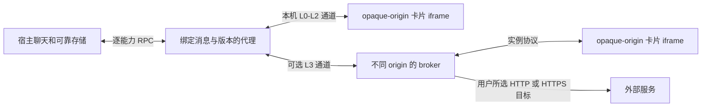

# F19 角色卡执行层专项设计

实施与发布更新（2026-10-03）：F18 声明式内核、可靠保存接入和 F19 主应用 L0–L3 已随 Sites 第 10 版发布；详细支持范围与验收以 [现行规格](spec.md) 为准，[发布记录](SITES.md) 已更新。下文原方案状态保留为编写时记录；L3 远端独立服务未部署。

当前实现限制：CSP 限制直接请求和资源；iframe 自身导航的请求可能已发出，load 后才停止并撤销，不作为绝对断网保证。浏览器也没有硬 CPU/内存限额。审核窗口明确提示仅运行可信卡片。

## 前期设计记录（以下状态保留为历史）

更新：2026-10-02。状态：专项设计与设置边界预工作已完成；**执行层尚未实现、未验收、未发布**。当前应用仍不执行角色卡 JavaScript，F20 TTS 已取消。

## 修订依据与实施边界

本轮根据主站当前源码重新核对 L0–L3，完整函数、快照摘要、文件清单及验收矩阵见 [F18/F19 主站源码仿写方案](F18-F19-主站源码仿写方案.md)。该方案取代初版中“首批只能 Worker 计算 + 受信显示”“全部执行都要独立 HTTPS 服务”和“实际样本是基础开发前置条件”的过严要求。

**用户已要求取消 HTTPS 硬限制。** 本项目支持 HTTP、本机地址和 HTTPS；不强制新域名。L0–L2 在当前页面的隔离 iframe 中实现；L3 保留不同 origin 的 broker，可用不同 HTTP 端口，也可用 HTTPS。样本用于实际兼容扩展与验收，不能阻塞已能从源码定义的基础实现。额外远端服务的实际部署仍需明确目标和批准，不把普通开发许可当作发布许可。

本轮只改文档及索引，不新增执行器、授权开关、空授权存储或服务。**不得修改无关业务、数据库、同步协议、部署配置或线上数据。** 下文为拟实现契约，不是已有运行能力。

## 已完成的设置边界

前一批已修改设置策略、云应用、对应回归与文档，bundle 由构建生成：

- F17 只净化静态消息。角色、消息和预设未知扩展保留为原始数据；字段名不代表许可。
- 可移植备份/同步上传与云恢复 settings 输入共用 `getCloudSyncPortableSettings`。修复前，本机缺失的 `futureAccessToken` 可被远端输入采用；修复后不再接收。
- 顶层现有连接/凭据/临时状态、名称以 `apiKey/token/secret/passphrase/password/credential/privateKey` 结尾的字段，以及 `__proto__/constructor/prototype` 均过滤。普通业务设置继续传输。
- 顶层 `cardRuntime`、`cardRuntimeEnabled`、`cardRuntimeGrants`、`cardRuntimePermissions` 排除在普通备份和云输入/输出之外；本机原有值恢复时保留，但没有执行器消费它们。未来也不把这些旧值或卡片同名元数据当作许可。
- 过滤只处理设置顶层，不扫描私人正文、不递归删除业务未知元数据。新凭据须登记整个本机专用命名空间或使用独立本机存储，不能隐藏在普通扩展里。
- 本机主/总结密钥及配对 API 地址保留，临时图片令牌不随远端恢复接收。未改变 v3 备份、同步协议或服务端结构。

## 隔离与层级

| 层级 | 支持目标 | 核心条件 |
| --- | --- | --- |
| 静态 | F17 正文与 F18 声明式模板 | 默认显示，不执行 JavaScript |
| L0 | 卡片自身内联 DOM 交互 | 本页 srcdoc、sandbox allow-scripts、用户明确确认 |
| L1 | L0 加固定兼容库/ABI | 本机发布的固定依赖，真实效果与明确不支持接口 |
| L2 | 固定第三方脚本/模块 | HTTP/HTTPS 下载或缓存，字节/摘要确认，运行期断网 |
| L3 | 经授权出站联网 | 不同 origin broker，可 HTTP/本机/HTTPS；卡片不拿宿主凭据 |

L0–L2 iframe 不允许 same-origin、顶层导航、弹窗、下载和表单权限。卡片代码只在 iframe 的自身 DOM 中执行，不能进入宿主 eval/Function 或获得宿主对象。L3 外层 broker 可以允许 same-origin 以保持自己的来源；内层卡片仍 opaque-origin，外层不能是宿主同源执行页。[HTML Standard](https://html.spec.whatwg.org/multipage/iframe-embed-object.html#attr-iframe-sandbox)

默认 CSP 分别限制 script/connect/img/font/style/media/frame/worker/object，不能只设置 connect-src 后宣称没有外部资源。远程媒体和联网分别授权。固定依赖从正式发行源取得，保留许可，运行前核验版本/字节/SHA-256；依赖缺失保持静态，不自动授权较低执行层。

不照搬主站正则组件的自动 L0 执行。L0 本身也是脚本运行，需要确认，不能用静态 HTML 净化替代运行隔离。

HTTP 下使用可用的 crypto.getRandomValues 生成令牌；原生 digest 不可用时用经过测试、锁定版本的本机 SHA-256 实现，不能改用 M1 快速指纹或强迫用户改 HTTPS。HTTPS 宿主加载 HTTP 资源可能受混合内容阻止，跨来源请求受 CORS/私有网络策略约束，按实际浏览器错误提示，不新增应用协议拒绝。[MDN getRandomValues](https://developer.mozilla.org/en-US/docs/Web/API/Crypto/getRandomValues)，[MDN digest](https://developer.mozilla.org/en-US/docs/Web/API/SubtleCrypto/digest)，[MDN mixed content](https://developer.mozilla.org/en-US/docs/Web/Security/Mixed_content)

## 授权、RPC 与变量写入

首批许可采用页面内存表，刷新后重新确认；不先创建永久授权数据库。绑定卡片身份、完整执行字节/依赖摘要、ABI、明确能力和网络策略。固定依赖缓存独立保存在本机，不随云同步；缓存不是许可。换代码/依赖/ABI/权限重新确认，同名卡、布尔设置、导入及云恢复不能自动开启。

握手验证 iframe 的窗口引用、实例 token 与输入结构，随后使用专用 MessagePort；每次 RPC 核验实例存活、会话/稳定消息 ID/选中版本、授权摘要、方法白名单、请求 ID 和大小/频率。opaque origin 的 null 不代表身份；L3 外层另验精确 broker origin。目标不存在时拒绝，不回退到当前聊天。

读聊天/角色/变量、当前变量写入、输入回填、生成、远程媒体及联网分别授权。只返回有界字段副本，不提供 settings、API Key、同步口令、CoT、其他聊天或全库快照。未知方法明确不支持，不返回成功空响应。SillyTavern/Mvu/TavernHelper 兼容名称仅映射已实现的方法，不加载任意宿主命令。

变量写入使用 F18 人工覆盖契约：只写绑定助手消息/选中版本，校验初始状态与前序来源链、单写者和限额，在独立候选回放后复用 persistConversationMutation。保存前后校验，通过完成确认后才发布状态、事件和成功响应；失败/撤销/换版本不覆盖现有内容。输入回填尊重当前聊天及 F14 编辑序号，生成须单独许可，不默认自动发送。

关闭/换会话/换版本/删消息/撤销时先使请求失效、关闭通道、取消订阅与网络、释放 Blob 和写入占用，再移除实例。已完成变量写入不回滚；未完成和迟到请求不能再提交，其他聊天与原始正文保留。

## 可选网络与移动端

L3 broker 的父页面白名单必须包含实际来源及端口；主站公开 broker 当前没有分站 Sites 来源，不能直接借其地址宣称可用。自有 broker 独立于现有同步 API 和 Worker 路由，不转发宿主密钥或借同步权限代请求。

用户选择的出站 origin 支持 HTTP/HTTPS，检测到 URL 不等于许可。精确绑定 scheme/host/port、方法和配额；credentials omit、敏感头排除、拒绝重定向、流式字节上限，超时覆盖完整响应体，撤销终止响应读取。日志不保存查询参数/正文/凭据。参考配额及主站生命周期差异见完整方案。

普通 iframe 没有硬 CPU/内存配额；DOM 卡片也不能全部搬到 Worker 而保持兼容。可终止 Worker 只用于适合的独立计算，不作为全部卡片运行前置。无限循环/内存压力和宿主交互恢复须在目标平台实际验收，不能用计时器宣称可靠终止。

主站禁用 Android/原生壳 L3；分站先验收桌面与 Android L0–L2，L3 按实际平台结果开放。不能把该限制扩大为所有移动设备，也不因 HTTP 自动禁用。HTTP、本机不同端口和 HTTPS 都进入浏览器矩阵。

## 实施、验收与回退

顺序为 F18 内核/可靠接入 → F19 L0/L1 → L2 固定依赖 → 可选 L3；准确候选文件、manifest 顺序和自建测试卡见 [完整方案](F18-F19-主站源码仿写方案.md)。代码开始前再次声明文件范围，**不得修改无关部分**。

执行验收覆盖真实 DOM/兼容库/固定模块运行、非法输入、无许可/source/token/方法伪造、旧实例重放、版本和保存竞态、撤销/资源限制、凭据与宿主存储隔离、HTTP 与 HTTPS、桌面/移动浅暗截图。真实用户卡片补充兼容范围；没有实际通过前不宣称支持全部主站接口、脚本卡或平台，不用占位 UI 交付。

前一批设置边界验收已通过完整检查（含 66 项 Python 测试）、Sites 构建、私有设置/F23 回归以及实际 applyCloudSyncSnapshot → StorageService 重新读取；详情见 [开发方案](主站功能对齐开发方案.md)第 9.1 节。**这些结果只证明设置边界，不证明尚未实现的 F18/F19。** 本轮仅做文档/源码证据检查，未发布。

回退停止实例、清理派生缓存、回到可用静态显示，不删除原始卡片/消息/版本/已保存变量，不撤销凭据过滤。未部署额外服务时没有服务撤销操作。
